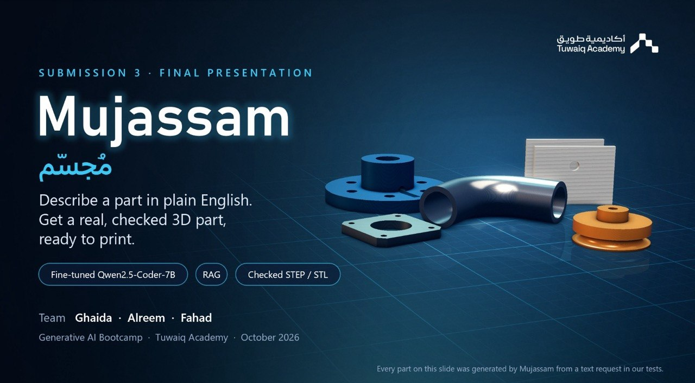
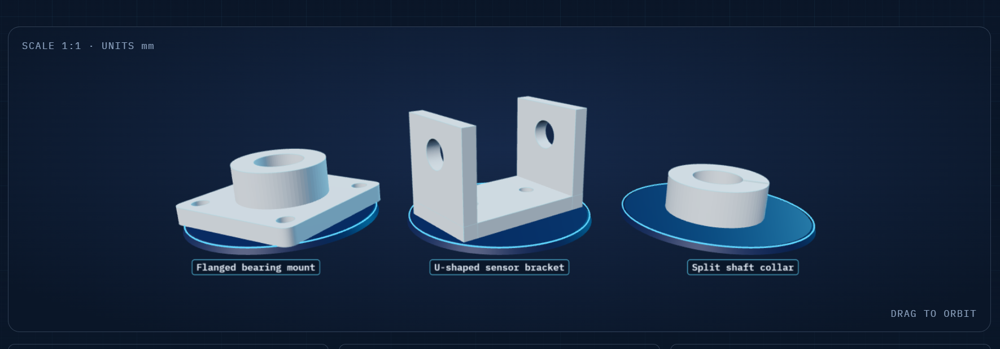

<h1><strong>Mujassam · مجسّم</strong></h1>

<h3>Natural Language → Parametric CAD → Verified Geometry → Printable Files</h3>

  
  &nbsp;
  

  
  
  
  
  

Ghaida Alsalamah · Alreem Rashed Aldossary · Fahad Alshehri

Tuwaiq Academy · Generative AI Application Engineering Bootcamp · October 2026

  

<h1><strong>THE PROBLEM</strong></h1>

A custom mechanical part may be simple in shape, but creating it still requires CAD knowledge, precise modelling, and time.

General-purpose language models can generate CAD-like code, but a plausible preview does not guarantee a usable part.

  
  
  
  

Mujassam was built so generated geometry is executed, measured, and checked before it is exported.

<h1><strong>THE SOLUTION</strong></h1>

Mujassam is a generative CAD tool for students, robotics teams, fab labs, and small workshops.

The user describes a mechanical part in plain English and provides its overall dimensions in millimetres. Mujassam retrieves relevant engineering knowledge, generates a parametric CadQuery program, executes the generated code, measures the resulting geometry, validates it, and exports the part only when the current checks pass.

  
  &nbsp;→&nbsp;
  
  &nbsp;→&nbsp;
  
  &nbsp;→&nbsp;
  

  
    Description + dimensions
    &nbsp;&nbsp;&nbsp;&nbsp;
    CadQuery generation
    &nbsp;&nbsp;&nbsp;&nbsp;
    Execute + measure + validate
    &nbsp;&nbsp;&nbsp;&nbsp;
    STEP · STL · GLB
  

<h1><strong>SYSTEM ARCHITECTURE</strong></h1>

  

<h2><strong>Where is the Generative AI?</strong></h2>

Qwen2.5-Coder-7B + QLoRA generates the CadQuery program for every request.

The final geometry is not produced by a hidden deterministic CAD compiler.

The surrounding pipeline handles:

retrieval → safety → execution → measurement → validation → repair → export

<h1><strong>REQUEST WORKFLOW</strong></h1>

  

If a build fails execution or validation, the failure information is returned to the model for another generation attempt.

Only an accepted result reaches export.

<h1><strong>MODEL & TECHNOLOGY</strong></h1>

Component

Final Choice

Base Model

Qwen/Qwen2.5-Coder-7B-Instruct

Adaptation

QLoRA

LoRA Configuration

rank 16 · alpha 32 · dropout 0.05

Quantization

4-bit NF4 + double quantization

Context Length

2,048 tokens

Trainable Parameters

~40.4M · ~0.53%

Embeddings

sentence-transformers/all-MiniLM-L6-v2

Vector Database

Chroma

CAD Engine

CadQuery

Exports

STEP · STL · GLB

<h1><strong>TRAINING DATA</strong></h1>

The final adapter is trained on project-generated procedural CAD data.

Parameterized generators create varied dimensions, optional features, natural-language requests, and an exact CadQuery target. The target is executed and verified before it can enter training.

<h2><strong>Dataset by Examples</strong></h2>

  

&nbsp;

  

&nbsp;

<h2><strong>Dataset by Part Types</strong></h2>

  
  
  
  

<h2><strong>Separate Validation & Test Sets</strong></h2>

42 generated validation cases

30 in-distribution

12 from the 2 validation-only part types

28 held-out part-type cases

7 unseen part types

4 requests per type

30 sealed user requests

20 independent reserve requests

20 in-domain regression requests

12 second in-domain regression requests

<h2><strong>Verification Before Training</strong></h2>

  
  
  
  
  

5,860 / 5,860 direct-generation targets passed the verification pipeline.

<h1><strong>FEATURE COMPOSITION</strong></h1>

The dataset does not only repeat complete named parts.

Six composition generators teach the model to combine 2–4 compatible CAD operations:

composed_plate · composed_block · composed_disc · composed_l_bracket · composed_ring · composed_tray

Examples:

base plate
+ mounting holes
+ pocket
+ chamfer

disc
+ centre bore
+ bolt circle
+ raised boss

L-bracket
+ adjustment slots
+ upright holes

This gives the model repeated practice with reusable geometry operations instead of only fixed object templates.

<h1><strong>FINE-TUNING vs RAG</strong></h1>

  

Fine-Tuning

QLoRA learns from:

5,860 verified generation examples

963 repair examples

feature-composition examples

Fine-tuning changes the adapter weights and teaches the model how to generate and repair CadQuery.

RAG

The runtime knowledge base contains:

16 engineering construction recipes

8 CadQuery API notes

MiniLM embeddings

Chroma retrieval

For each request, Mujassam retrieves at most:

1 engineering recipe + 2 API notes

RAG supplies context to the fine-tuned model. It does not retrieve the finished CAD program.

<h1><strong>REPRESENTATIVE OUTPUTS</strong></h1>

These examples are taken directly from actual Mujassam-generated CAD outputs.

  

  
  
  

The project also generated additional parts such as flanges, pulleys, fan guards, mounting plates, and curved tube geometry during testing.

<h1><strong>BEFORE vs AFTER FINE-TUNING</strong></h1>

To measure the effect of model adaptation, the untouched Qwen2.5-Coder-7B-Instruct baseline was compared against the final Mujassam QLoRA-adapted model on the exact same locked regression requests.

Both conditions used the same RAG context, system prompt, CadQuery executor, validator, feature checks, greedy decoding, and one generation attempt. The only model difference was QLoRA OFF vs QLoRA ON.

<h2><strong>Overall-Size Pass</strong></h2>

Evaluation Set

Base Qwen2.5-Coder-7B

Mujassam Fine-Tuned

In-Domain Regression

7/20 · 35.0%

20/20 · 100.0%

Second In-Domain Regression

1/12 · 8.3%

12/12 · 100.0%

<h2><strong>Size + Requested Holes</strong></h2>

Evaluation Set

Base Qwen2.5-Coder-7B

Mujassam Fine-Tuned

In-Domain Regression

2/20 · 10.0%

20/20 · 100.0%

Second In-Domain Regression

0/12 · 0.0%

12/12 · 100.0%

  
  

The paired comparison shows that QLoRA adaptation substantially improved reliable generation on the learned CAD operation distribution.

<h1><strong>EVALUATION</strong></h1>

<h2><strong>Final Frozen-Model Results</strong></h2>

Evaluation Set

Cases

Overall-Size Pass

Size + Requested Holes

In-Domain Regression

20

20/20 · 100%

20/20 · 100%

Second In-Domain Regression

12

12/12 · 100%

12/12 · 100%

Sealed User Test

30

13/30 · 43.3%

11/30 · 36.7%

Held-Out Part Types

28

10/28 · 35.7%

7/28 · 25.0%

Independent Reserve

20

5/20 · 25.0%

4/20 · 20.0%

<h2><strong>Sealed Test by Difficulty</strong></h2>

  
  
  

<h2><strong>Main Sealed-Test Failure Modes</strong></h2>

  
  
  

The model performs strongly on familiar CAD operations.

The main remaining challenge is generalization to unfamiliar geometry and more complex feature relationships.

<h1><strong>VALIDATION</strong></h1>

<h2><strong>Automatically Checked</strong></h2>

  
  
  
  
  
  

<h2><strong>Still Requires Human Review</strong></h2>

Advanced sweeps and lofts · unusual slots · subtle feature orientation · structural suitability · final physical fit

Mujassam is a capstone prototype, not an engineering-certification system.

<h1><strong>LIVE DEMO</strong></h1>

Open Mujassam →

Watch the Demo Video →

<h1><strong>TEAM</strong></h1>

  
  &nbsp;&nbsp;&nbsp;&nbsp;&nbsp;&nbsp;
  
  &nbsp;&nbsp;&nbsp;&nbsp;&nbsp;&nbsp;
  

  <strong>Ghaida Alsalamah</strong>
  &nbsp;&nbsp;&nbsp;&nbsp;&nbsp;&nbsp;&nbsp;&nbsp;
  <strong>Alreem Aldossary</strong>
  &nbsp;&nbsp;&nbsp;&nbsp;&nbsp;&nbsp;&nbsp;&nbsp;
  <strong>Fahad Alshehri</strong>

<h2><strong>RUN THE PROJECT</strong></h2>

Colab

Open Mujassam_demo.ipynb.

Select a T4 GPU or better.

Run the cells in order.

Upload the project ZIP when requested.

Upload the trained QLoRA adapter ZIP when requested.

Wait for the model and adapter to load.

Launch the application.

Example:

Flanged bearing mount, overall 48 x 48 x 18 mm,
24 mm central bore, four 4 mm mounting holes
on a 36 mm square pattern.

Local Setup

git clone https://github.com/ghaida-alsalamah/Mujassam.git
cd Mujassam

python -m venv .venv

Windows:

.venv\Scripts\activate

macOS / Linux:

source .venv/bin/activate

Install dependencies:

pip install -r requirements.txt

A CUDA-capable GPU is recommended for local 7B inference.

<h2><strong>REPOSITORY STRUCTURE</strong></h2>

Mujassam/
├── README.md
├── requirements.txt
├── app.py
├── Mujassam_demo.ipynb
├── mujassam/
├── data/
├── scripts/
├── tests/
├── results/
└── docs/
    └── assets/
        ├── mujassam-hero.jpg
        └── mujassam-outputs.png

<h2><strong>DATA SOURCES & LICENCES</strong></h2>

Resource

Role

Qwen2.5-Coder-7B-Instruct

base code model · Apache-2.0

Project-generated procedural CAD data

fine-tuning supervision

all-MiniLM-L6-v2

RAG embeddings

Chroma

vector retrieval

CadQuery

parametric CAD execution

Transformers · PEFT · bitsandbytes

model loading, QLoRA, quantized inference

No external CAD dataset is used to train the final adapter.

<h2><strong>MONITORING & RESPONSIBLE USE</strong></h2>

Each build records:

request · model · retrieval scores · pass/fail · rejected gate · error type · attempts · dimension error · latency

Safeguards include:

generated Python passes an AST safety filter;

CadQuery runs in an isolated subprocess with a timeout;

rejected outputs are not exported;

unambiguous weapon and ammunition-part requests are rejected before generation;

users are warned that generated parts are not engineering-certified;

users are asked not to enter personal information because requests may be logged.

<h2><strong>LESSONS & NEXT STEPS</strong></h2>

What Worked

Verified procedural training data · code-focused QLoRA · compact engineering RAG · execution-based validation

Main Limitation

Generalization drops when a request requires genuinely unfamiliar topology or feature relationships.

Next Steps

Stronger semantic validation · broader geometry coverage · persistent GPU deployment · Arabic input support · more real-world fit testing

<h1><strong>Mujassam · مجسّم</strong></h1>

Describe It · Generate It · Check It · Print It

  

Ghaida Alsalamah · Alreem Aldossary · Fahad Alshehri

  

Repository: https://github.com/ghaida-alsalamah/Mujassam

